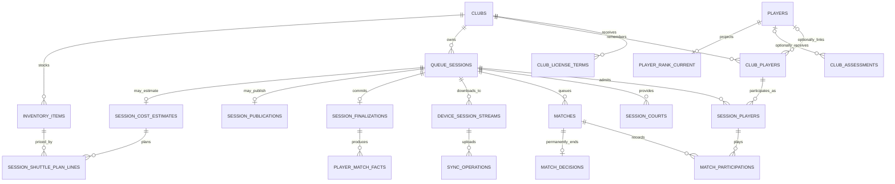

# V1 product database design

**Last verified:** 2026-10-28 for the entity inventory and F07 planning links.

**Status:** Proposed design, not an executable schema. **Baseline:** October 25, 2026; Queue records updated October 26, 2026 for the [ROTRA Queue prototype](../../frames/queue-app/rotra-queue.html) (cost estimates with misc entrance fees and a break-even or custom payment per player, payment marks, inventory, waitlist and first-come budget changes, court closing times, calculated minimum, match numbers, re-publication, club name-change requests). Admin records updated October 27, 2026 for the [ROTRA Admin prototype](../../frames/admin-app/rotra-admin.html) (owner-added clubs, per-club or free license prices, owner-created feature flags). Device-only preferences such as the light/dark theme are not stored.

## Scope and reading order

| Document | Purpose |
|---|---|
| [Conventions](conventions.md) | Types, tenant keys, ownership, constraints, and versioning |
| [Queue](queue/README.md) | Club players, sessions, queue, matches, recovery, results, cost estimates, inventory |
| [Player Information](player-information/README.md) | Independent player identity, contacts, RTR IDs, rolling rank |
| [Admin](admin/README.md) | Clubs, licenses, configuration, contact approval |
| [Transaction boundaries](transactions.md) | Operations that must succeed together or be retried safely |
| [Access and retention](access-retention.md) | Private contacts, public projections, licensing, deletion |
| [Decisions before migrations](open-decisions.md) | Technical proposals and remaining blockers |
| [Command contracts](command-contracts.md) | Current fetchers/hooks, actors, states, retries and decision gates |
| [Schema dependencies](schema-dependencies.md) | Proposed FK graph, insertion cycles and migration ordering gates |

Business source: [ecosystem v1](../../business_logic/product/README.md). World is v2; no World tables are proposed.

## Storage boundary

**Proposal:** one PostgreSQL database with product-owned logical modules and explicit cross-product foreign keys. Separate products do not require three independent databases or copies of player identity. Physical schemas and deployment boundaries remain undecided.

The server database is authoritative after reconciliation. A downloaded device holds a scoped working copy and durable operation log; it is not a second independently authoritative player database.

## Main relationships

This is an overview, not every FK. In particular, an assessment belongs to a club and a roster entry; guest assessments remain possible before a global player exists.

## Key separations

1. **Authentication account versus player identity.** A profile may exist unclaimed, with no login. Club credentials do not require a fictional player profile.
2. **Club player versus global player.** A name-only guest has a durable club identity and session history but no global profile.
3. **Current rank versus session level.** Rank evolves; the level used for a player's session is locked.
4. **Waiting match versus court assignment.** The queue is shared. Courts are acquired only when a match starts.
5. **Raw offline operation versus accepted result.** Replayed uploads cannot silently overwrite a confirmed result.
6. **Session finalization versus publication.** Rank updates do not wait for slide publication.
7. **Public page versus durable history.** Six-month page deletion does not cascade into match facts.

## Proposed entity inventory

| Owner | Records |
|---|---|
| Admin/shared | `clubs`, `club_accounts`, `admin_accounts`, `club_license_terms`, `club_entitlements`, `club_expiry_cycles`, `club_name_change_requests`, `ranking_policy_versions`, `feature_flags`, `player_contact_change_requests`, `admin_audit_events` |
| Queue | `club_players`, `club_player_private_inputs`, `club_venues`, `queue_sessions`, `club_session_reservations`, `session_players`, `session_waitlist`, `session_join_requests`, `session_courts`, `matches`, `match_participations`, `match_court_usage`, `active_player_holds`, `active_court_holds`, `match_decisions` |
| Queue sync | `devices`, `device_session_streams`, `sync_operations`, `sync_conflicts`, `session_finalizations`, `projection_jobs` |
| Results | `player_match_facts`, `club_session_player_summaries`, `session_result_snapshots`, `session_publications`, `session_publication_events`, `result_exports` |
| Queue financials | `inventory_items`, `session_cost_estimates`, `session_shuttle_plan_lines`, `session_payment_marks` — estimates and manual paid marks; ROTRA does not collect money |
| Player Information | `players`, `player_private_contacts`, `player_accounts`, `player_social_links`, `player_claim_links`, `player_id_allocations`, `player_id_counters`, `location_codes`, `skill_levels`, `club_assessments`, `player_rank_current` |

These are logical records. Small one-to-one projections may be combined in physical design if access, immutability, and lifecycle boundaries remain intact. Do not convert this inventory mechanically into migrations.
