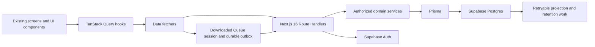

# Supabase database and frontend integration plan

**Prepared:** October 28, 2026. **Status:** proposed sequence, with explicit decision gates.

ROTRA can keep its Next.js 16 screens and reusable components while replacing mock behavior in controlled steps. First reconcile the [database review](validation-review.md), then build server enforcement and connect complete user journeys. The owner approved private online testing first on October 28, 2026. Offline operation and recovery remain required before clubs use the system live.

Other decisions approved on October 28: create phone-linked profiles and permanent RTR IDs as soon as the entry successfully syncs; include earlier valid guest games in personal history and ranking after identity confirmation, under existing eligibility/window rules. Existing profiles are reused. Match performance still requires valid finalization, and historical games retain their original dates and outcomes. The identity-confirmation process and auditable linkage implementation remain to be specified.

This plan does not apply migrations, provision paid resources, or authorize production data changes. The owner subsequently authorized backlog creation: [F07 #241](https://github.com/jose-codegourmet/rotra-v2/issues/241) contains tickets 194–227, including [command-contract reconciliation #242](https://github.com/jose-codegourmet/rotra-v2/issues/242) and focused decision gates #243–#248. Existing frontend work can continue against documented mock contracts. New decisions must be recorded in the source business/screen/database docs before dependent implementation starts.

Phase 0 artifacts: [current command/read contracts](command-contracts.md), [callable catalog](callable-catalog.md), and [schema dependency graph](schema-dependencies.md). These inventory the existing interface and expose blockers; they do not freeze unresolved product behavior or approve API routes.

## Intended data flow

The offline arrow applies only to approved Queue actions. The browser never receives database credentials. Publication, player history, and rankings are separate outputs of accepted data. Worker hosting and scheduling remain an implementation decision, not an assumed new platform.

Retain the established boundaries:

- Visual components and forms stay in `@rotra/ui`; route containers wire data to them.
- `@rotra/data` keeps frontend contracts, hooks, query keys, and approved pure domain rules. Fixtures remain available for Storybook.
- `@rotra/db` is the planned server-only Prisma/service package, with split schema files by entity group. Creating the package and selecting dependencies need the repository's recorded decision.
- Next.js Route Handlers remain the business-write path. No Server Actions or Supabase Realtime are introduced.
- Verify identity and authorization in services/handlers; `proxy.ts` is not the sole security boundary. Await Next.js 16 request APIs and read the installed version's guides before changing routing/auth/caching.

## Phase 0 Reconcile requirements and freeze contracts

**Depends on:** this review and focused owner answers. **Produces:** build-ready rules, not tables.

1. Correct the definite documentation drift in R3, R6–R7, R10, and the review's reconciliation table. Resolve ambiguous parts explicitly; do not treat a correction to a reference formula as production approval.
2. Apply the three recorded owner decisions: profile/ID creation on successful entry sync, historical guest-game inclusion after identity confirmation, and private online testing before offline completion. Specify the identity-confirmation evidence and auditable attribution mechanism before implementing historical linkage; those details were not decided by choosing inclusion.
3. Resolve R1–R2 and R4–R5 with concrete before/after examples for payments, roster movement, guest invitations, and visitor request status.
4. Freeze a command/read inventory from existing `fetchers.ts`, hooks, screen IDs, and business actions. For each, record actor, input, permitted state, output, errors, offline availability, retry identity, and affected queries. Propose exact API routes separately; screen IDs do not become endpoint names automatically.
5. Establish what is immutable at Match done versus Session done, and what remains mutable afterward: payments and publication need their own permitted lifecycle.
6. Agree integration ownership with the ongoing frontend work. Recheck the latest code before switching any module; this review's baseline is not a promise that active branches stay unchanged.

**Acceptance:** no dependent ticket relies on an unanswered decision; every proposed database command has an existing product purpose and screen consumer. Use the existing Components → Storybook → Mock data → Screens → States order for any missing UI pieces. A backend task does not require invented placeholder components.

## Phase 1 Choose database ownership and prepare an isolated environment

**Depends on:** Phase 0 for the initial domain slice. **Produces:** approved environment and migration approach.

1. Identify the intended Supabase project/environment, whether it is empty, and whether any real records must be preserved. Inspect existing tables and migration history read-only before writing a schema. Do not assume the missing local database package means an empty remote database.
2. Confirm the Prisma version against current releases and repository compatibility. The existing Prisma 7 recommendation is not a version selection already made by this plan.
3. Choose one migration authority. The repository currently describes Prisma migrations; recommend retaining one reviewed history there if approved. Do not independently apply equivalent DDL through Prisma, Supabase migrations, dashboard SQL, and MCP. Define how SQL-only features enter that same history and how Supabase-managed Auth/Storage schemas stay outside ordinary application schema ownership.
4. Approve physical schemas and access exposure. Prefer application operational/contact data outside the Data API where compatible with the selected architecture. Explicitly enumerate exposed objects, grants, RLS policies, view behavior, and worker privileges.
5. Separate migration privileges from runtime privileges. Prisma's server connection must not be assumed to inherit an end-user JWT or automatically enforce their RLS scope. Specify the real authorization and privilege mechanism and verify it using the runtime role.
6. Select runtime pooling and migration connections for the actual host/network/driver combination; verify transaction and prepared-statement compatibility. Bound connections and query/transaction timeouts. Never place database URLs or secret/service-role keys in public environment variables.
7. Prepare a disposable development database and nonproduction verification environment with fictional data, including two clubs and overlapping/same-name players. Select backup/restore and release procedures before any production migration.

**Acceptance:** the approved migration history can recreate the application schema in a disposable database; each managed object has one owner; credentials and project targets are unambiguous. Each migration receives human sign-off as required by [coding conventions §13](../../coding-conventions.md#13-database-later-epic). Sign-off comes after the SQL and its validation evidence are reviewable.

## Phase 2 Real authentication and account boundaries

**Depends on:** Phase 1 plus approved auth/claim/contact decisions. **Produces:** correctly separated club, player, and platform-owner access.

First complete the account contracts and provider validation with fictional data. Those decisions unblock Phase 3's account tables. Complete the application-backed auth integration below after those schema groups exist, before Phase 4. This is a deliberate two-part phase; schema design does not wait on finished handlers that already require that schema.

1. Specify Supabase account mapping for club username/password, player phone-or-email/password, and platform-owner sign-in. Supabase password auth supports phone/email identifiers; the club username adapter and one-account/two-player-identifiers provisioning must be designed and verified rather than assumed.
2. Approve claim-link issuance, guest invitation handling, expiry/reissue, email verification, and recovery. Keep registration tied to the intended identity; public RTR IDs are identifiers only. Do not introduce SMS/social-login steps without a decision.
3. Implement server-side session verification and cookie refresh for each app using current Supabase SSR guidance, `proxy.ts`, and permitted Route Handlers. Check account type and current server-owned account state on every protected read/write.
4. Replace mock cookies, demo account defaults, and permissive mock sign-in in the real-data configuration. Preserve Storybook/mock operation as a separate development path, never an authentication fallback after an API failure.
5. Implement repeat-safe staged provisioning and contact changes across Auth and application records. Provider failure, lost responses, and collisions must resume the same operation. Do not hold a database transaction open around an external Auth call.
6. Enforce contact-change approval across all reachable provider and application APIs. Verify that a signed-in player cannot bypass it with a direct Auth request. Confirm reset/change-password behavior and its effect on other devices without erasing unsynced Queue work.
7. Approve sender/SMTP/template and redirect configuration for real verification/reset emails. This phase plans the integration; it does not send messages to users.

**Acceptance:** sign in/out, refresh, claim, expired link, reset, wrong account type, and partial provisioning each produce truthful states. Direct requests to a different club/player's data fail. No mock marker grants real access. Account deletion/disable behavior cannot cascade away permanent results.

## Phase 3 Implement the schema in dependency groups

**Depends on:** Phase 1, relevant Phase 0 decisions, and Phase 2's account mapping. **Produces:** reviewed schema groups and explicit invariants.

| Order | Existing proposed records | Main invariants and decisions |
|---|---|---|
| A | `location_codes`, `skill_levels`, `clubs`, `club_accounts`, `admin_accounts` | Nine levels; approved location codes; unique names/usernames; free/paid price rules; provider mapping and provisioning lifecycle. |
| B | `club_license_terms`, `club_entitlements`, `club_expiry_cycles`, `club_name_change_requests`, `admin_audit_events`, `feature_flags`, `ranking_policy_versions` | Repeat-safe activation; approved renewal dates; historical amounts retained; one current expiry cycle; reviewed name changes; immutable flag keys and policy versions. |
| C | `players`, `player_private_contacts`, `player_accounts`, `player_social_links`, `player_claim_links`, `player_id_counters`, `player_id_allocations` | Independent identity/account keys; private normalized contacts; atomic phone/ID allocation on successful entry sync; approved invitation and claim transitions; reviewed historical guest attribution. |
| D | `club_players`, `club_player_private_inputs`, `club_venues`, `queue_sessions`, `club_session_reservations`, `session_courts`, `session_players`, `session_waitlist`, `session_join_requests`, `club_assessments` | Scoped FKs; approved deletion/demotion lifecycle; no roster/waitlist duplication; capacity changes; no schedule clashes; frozen active levels; safe visitor status ownership. |
| E | `devices`, `device_session_streams`, `sync_operations`, `sync_conflicts` | Stable command identity, scope, payload version and retry rules. Physical ordering must accommodate references from assessments and match evidence. |
| F | `matches`, `match_participations`, `match_court_usage`, `active_player_holds`, `active_court_holds`, `match_decisions` | Atomic occupancy; approved numbering; valid team sizes; frozen terminal evidence; full/partial participation derived from segments. |
| G | `inventory_items`, `session_cost_estimates`, `session_shuttle_plan_lines`, `session_payment_marks` | Scoped inventory; centavo storage and explicit rounding; recorded paid amounts; approved offline/post-finalization lifecycle; no stock deduction. |
| H | `session_finalizations`, `player_match_facts`, `club_session_player_summaries`, `session_result_snapshots`, `projection_jobs`, `player_rank_current`, `session_publications`, `session_publication_events`, `result_exports`, `player_contact_change_requests` | Unique facts/job sources; finalization provenance; reviewed projection visibility; private-by-default output; repeat-safe contact application; non-cascading retention. |

This is an implementation grouping, not a requirement to create every table mechanically or in one migration. Draw the complete foreign-key graph first. Create shared command/provenance records before dependent FKs, or add reviewed constraints in a later step. Resolve the roster/assessment cycle intentionally. Do not insert fake history just to satisfy a required reference.

For each group, list nullability, state transitions, uniqueness, checks, composite FKs, delete behavior, indexes, role permissions, and retry contracts. Use SQL support where the selected Prisma version cannot faithfully express a required exclusion/partial/deferred constraint; verify that migration regeneration preserves it.

**Acceptance:** demonstrate that cross-club links, duplicate identity allocation, overlapping accepted sessions, duplicate terminal decisions, and illegal level/result changes are rejected. Review indexes against the actual screen queries rather than adding one per column.

## Phase 4 Connect a complete preparation journey

**Depends on:** relevant Phase 3 groups and real authorization. **Produces:** a private end-to-end real-data path.

Connect the smallest useful journey: platform owner adds/activates a club → club signs in → saves a venue → creates a Queue Session → adds a guest → sets a level → reloads and sees the saved preparation. Use approved licensing rules; a development fixture does not prove production license activation works.

Then add club settings/name requests, saved-player lookup, request confirmation/decline, waitlist ordering, capacity changes, costs, and manual payment marks. Every transaction revalidates the actor, entitlement, session state, ownership, and expected revision. Get identity matching/claiming to use the same approved identity service across apps. Verify that successful phone-entry sync makes the profile and permanent RTR ID available before Session done, and that concurrent syncs reuse one identity rather than allocate duplicates.

**Acceptance:** a fresh browser sees persisted data; another club cannot read it; two simultaneous slot confirmations cannot bypass capacity behavior; a repeated setup/request command does not duplicate records; public details show only accepted safe values. Failed saves preserve form input and never claim server persistence.

## Phase 5 Connect live matches using the final command contract

**Depends on:** Phase 4, match/provenance schema, approved queue rules. **Produces:** durable online play suitable for private testing.

1. Start a session with locked levels and correct authorization. Allow future preparation while enforcing one active session.
2. Connect manual lineups, Make match, Suggest, Auto queue, reorder, and regenerate with the existing query contracts. Keep reference heuristics explicitly identified until approved for production.
3. Revalidate participants and acquire all courts/players atomically at Start match. Handle 5v5 as two courts for one game.
4. Record substitutions without losing outgoing/incoming segments. Finish/invalid commands append the permanent decision and free occupancy together.
5. Use stable operation IDs and revision checks from the beginning, including online commands, so offline sync later reuses the same domain semantics.
6. Connect live standings and session history to truthful projections; no live game enters official global performance before valid finalization.

**Acceptance:** concurrent starts cannot double-use a court/player; winner-only games keep null scores; invalid/partial games receive the correct zero credit; retries never count twice; confirmed outcomes cannot be edited through any app role. This phase is not a live-club release while offline integrity is incomplete.

## Phase 6 Add durable offline operation and recovery

**Depends on:** Phase 5 and the approved offline decisions in R9. **Produces:** the required downloaded-session behavior.

1. Implement the approved session download/enrollment/reservation process. A downloaded UI alone is not a write authorization. Keep the minimum permitted data, including the payment information approved under R1.
2. Persist each local accepted change and outbox entry atomically in IndexedDB. Show local success only after durable persistence. Check browser support, storage failure, eviction, refresh, and unsynced logout behavior.
3. Upload automatically on reconnect; distinguish received, accepted, rejected, and conflicted operations. Keep contiguous acknowledgement and causal prerequisites. Retry with the original operation ID.
4. Reconcile accepted server state with local pending work without dropping either. Query hooks read the appropriate working copy and show the documented save/sync labels.
5. Implement second-device continuation, match numbering, original-device recovery, conflict handling, stream closure, and session completion barrier exactly as approved.
6. Preserve the active-session license-expiry exception; prohibit unrelated expired-club access and new unauthorized offline starts.
7. Handle allowed payment updates separately from sealed match evidence according to R1. No reopening of completed game decisions.

**Acceptance:** demonstrate the complete two-device scenario, including missing original operations, gaps/out-of-order delivery, changed retry payloads, lost responses, concurrent conflicting outcomes, a never-used download, and permanently missing originals. Finalization stays blocked when required evidence is absent. A storage-write failure never shows a permanent winner as successfully saved.

## Phase 7 Finalization, player records, and ranking

**Depends on:** Phase 6 for release acceptance, approved formulas and historical identity-confirmation design, result schema. Profile creation timing and guest-game inclusion are settled. **Produces:** reliable official history and calculated output.

1. Lock the session and verify all required evidence, stream closures, revision, no active matches, and unresolved conflicts. A minimum-game shortfall is only a warning.
2. Commit one finalization and its authoritative facts atomically, along with repeat-safe downstream work. Invalid sessions contribute nothing official.
3. Project club summaries, private result snapshots, global player history, and approved ranking inputs. After confirmed historical guest linkage, include earlier valid games in personal history and recompute eligible rank/leaderboard inputs. Preserve original facts, club history, and played dates. Use reviewed attribution and repeat-safe projection work so retries neither omit history nor count it twice. Do not transfer by name alone or include invalid/partial/fun games in global performance.
4. Run versioned rank/award calculations from frozen evidence. Handle sparse data, missing scores, fun/partial games, multi-player standings ties, policy updates, and time-boundary ageing using approved examples.
5. Make progress states recoverable after reload/lost response. If facts committed but slides fail, retry rendering/projection only. Keep public ranking and explanation coherent with the effective calculation version.

**Acceptance:** retrying Session done cannot duplicate facts, wins, IDs, or awards. A profile/history update is independent of publication. Linking a confirmed guest with prior valid standard games updates personal history and eligible ranking inputs once; old games remain outside the rolling window when their original dates are too old. Unconfirmed or conflicting links transfer nothing. Ageing removes expired leaderboard eligibility even without new games. Missing evidence is never converted to a fake zero rank. Required money/ranking tests pass.

## Phase 8 Publication, media, Admin completion, and retention

**Depends on:** Phase 7 plus approved public visibility and retention decisions. **Produces:** all remaining real-data user journeys.

1. Publish only selected slides with a fresh explicit Off Day choice. Record publication events. Re-publication must update data and generated-asset access consistently; old public assets must follow the approved retention/access policy.
2. Implement Story/Feed exports using private assets and deliberate authorization. Verify all rows paginate at the documented 14/10 limits. Public media and private results require distinct access treatment; storage implementation is not implied by an `avatar_ref` or asset string alone.
3. Wire player profile editing, phone privacy, claim status, and approved contact requests end to end with Admin approval/application states. Public responses use allowlisted fields, including any approved social/opponent-history fields.
4. Finish Admin pricing, license history, effective ranking settings, feature flags, and activity read models. A created flag has an effect only if approved application code consumes that key.
5. Implement expiry-cycle jobs, renewal cancellation, stale-page behavior, publication/cache/asset cleanup, and failure recovery. Recheck the exact cycle before external asset deletion. No public-page deletion cascades to match facts or identities.
6. Select and verify the scheduler/worker runtime for rank ageing, projection retries, and retention. Include job idempotency, bounded retries, actionable failures, and redacted diagnostics.

**Acceptance:** private Off Day is absent from JSON, HTML, image URLs, and caches; renewal cannot lose pages to an old deletion job; deleting a public page preserves player history; approved-but-unapplied contact changes never display as successful; private contacts never enter public caches or exports.

## Frontend wiring checklist by existing domain

| Existing `packages/data/src/` domain | Screens and work to connect | Refresh after accepted changes |
|---|---|---|
| `auth`, `admin-account`, `player-account` | Sign-in, claim/recovery, own-account state | Current account, protected data; clear the prior account's query data on account change without discarding unsynced Queue evidence. |
| `club`, `club-venue`, `license` | Club settings, venues, access gate; A-CLUBS/A-LICENSE | Club, venues, entitlement, license history, affected public branding. |
| `queue-session`, `session-roster`, `club-player` | Q-SETUP, Q-PREPARE, Q-ROSTER, Q-SAVED-PLAYERS | Session summary, courts, roster/waitlist, minimum, directory, public participants, costs/payments where affected. |
| `public-session` | Q-PUBLIC-DETAILS/PARTICIPANTS/JOIN | Safe last-accepted public page and only the current visitor's request. |
| `match` | Q-QUEUE, Q-DISPATCH, Q-ACTIVE-MATCH, Q-MATCH-DONE | Queue, occupancy, participant availability, counters, live standings, review summary. |
| `inventory`, `session-cost`, `session-payment` | Q-INVENTORY, Q-FINANCIALS, Q-PAYMENTS | Inventory/cost summaries under approved pricing policy; payment amounts and totals; never public financial data. |
| `device`, `sync` | Q-DOWNLOAD, Q-SYNC, Q-DEVICE-CONTINUE, Q-CONFLICT | Local readiness/outbox, accepted revisions, conflict/integrity summaries; no invented whole-session sync claim. |
| `session-result`, `queue-session` | Q-SESSION-DONE, Q-RESULTS, Q-HISTORY, Q-PUBLISH, Q-EXPORT | Finalization status, private results, publication, official history; rank only when calculation is ready. |
| `player`, `leaderboard`, `ranking-settings` | P-PUBLIC-PROFILE, P-OWN-PROFILE, P-MATCH-HISTORY, P-LEADERBOARD, A-RANK-CONFIG | Own/public profile separately, history, coherent rank/eligibility/settings, private request status. |

Before each switch, compare current hook return types and mutation errors with the approved contract. Serialize UUIDs, timestamps, bigint revisions, money, and nulls explicitly at the API boundary. Never return Prisma objects wholesale or import the database package into browser code. Keep private session responses out of shared caches, and prevent old-user query responses from appearing after account switching.

TanStack Query can continue to refetch without Realtime. Stable mutation IDs belong to the user action, not a fresh ID on each HTTP retry. Disable duplicate submission for permanent confirmations and recover an uncertain result by status lookup before offering another attempt.

## Verification and release gates

The repository requires lint, type-check, build, and relevant manual verification. It requires unit tests for money/ranking and allows existing narrow phone/queue tests. Additional database/API/security automation needs an explicit testing-policy decision; until then, execute and record the following checks manually in an isolated database. Do not silently broaden the test framework or dependencies.

| Gate | Required evidence |
|---|---|
| Data integrity | Two-club isolation; cross-scope FK rejection; concurrent identity/slot/match operations; null/zero money; durable references through roster changes. |
| Auth and privacy | Forged mock cookie denied; wrong audience denied; direct API/contact bypass denied; hidden contacts and private Off Day absent from responses, logs, caches, and assets. |
| Offline durability | Refresh/interruption/storage failure; automatic replay; duplicates/gaps/conflicts; original-device recovery; licence expiry; finalized payment behavior. |
| Finality and calculations | Immutable results; one finalization/fact set; no invalid/partial/fun rank contribution; versioned expected math; timer-driven ageing. |
| Retention and recovery | Renewal races; retryable asset cleanup; no historical cascade; restore rehearsal on nonproduction data. |
| Frontend | Existing prototype flows at 375 px/1280 px, dark/light; keyboard; loading/empty/error/offline/permission states; real save survives a new browser session. |
| Operational readiness | Chosen project's advisors, representative query plans, bounded pooling, failed-job visibility, backups, approved migration and rollback/forward-fix procedure. |

Ship complete domain journeys into private verification. For a production failure after real writes, do not fall back to the in-memory mock or erase local evidence; preserve data and apply the approved recovery procedure. Public/live-club release waits for the full required offline and permanent-result guarantees, approved calculations, and privacy/retention behavior.

Before opening any additional epic, obtain the owner's go-ahead under [ways of working](../../ways-of-working.md#3-how-work-is-organised). F07 now tracks the authorized database scope with dependencies and acceptance examples. Consult its current issue states before picking up work; remaining browser offline support and full frontend adapter rollout are not automatically completed by the first persisted preparation journey.

## Current platform references

- [Supabase password authentication](https://supabase.com/docs/guides/auth/passwords): phone/email support; account provisioning must fit ROTRA's approved claim flow.
- [Supabase SSR client and session verification](https://supabase.com/docs/guides/auth/server-side/nextjs): verified sessions, cookie refresh, and cache considerations. Adapt examples to ROTRA's Route Handler policy rather than copying Server Actions.
- [Next.js authentication and Route Handlers](https://nextjs.org/docs/app/guides/authentication): authorization belongs at the data access/request boundary as well as navigation.
- [Supabase connection methods](https://supabase.com/docs/guides/database/connecting-to-postgres): select pooling versus direct/session connections for the actual runtime and migration environment.
- [Supabase RLS](https://supabase.com/docs/guides/database/postgres/row-level-security) and [Prisma troubleshooting](https://supabase.com/docs/guides/database/prisma/prisma-troubleshooting): verify runtime privileges and migration ownership; never assume an elevated connection is tenant-scoped.

These references were checked on October 28, 2026. Exact library versions, dependencies, physical schema names, worker hosting, and API endpoints remain subject to implementation review and the repository's decision requirements.
