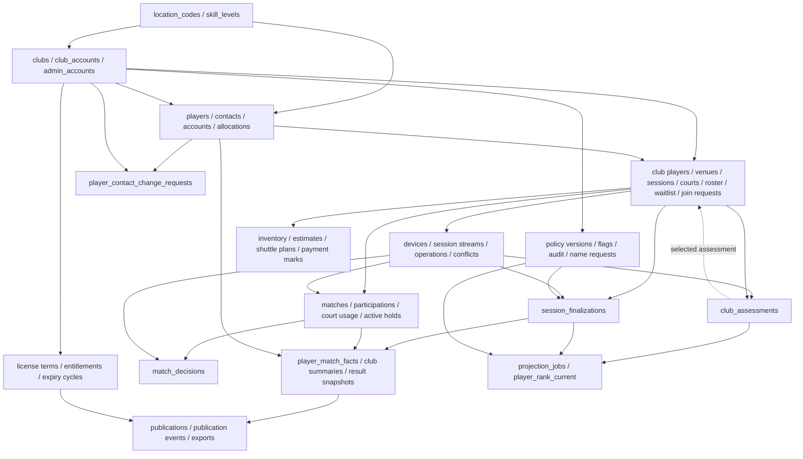

# Proposed schema dependencies

**Last verified:** 2026-10-28 · **Ticket:** [#242](https://github.com/jose-codegourmet/rotra-v2/issues/242).

This is a dependency review of the existing logical records, not migration SQL or a newly approved physical schema. The [entity inventory](README.md#proposed-entity-inventory) lists every group. An arrow below means the child needs the parent's identity/provenance; it is not permission for cascading deletion. All club/session edges must retain the composite scope keys in [conventions](conventions.md#tenant-keys). State, cardinality and public access need separate enforcement.

## Cross-group graph

The graph groups related records for readability; the table below qualifies optional links and cycles. In particular, devices depend on club/account identity, while streams also depend on sessions; not every record in a grouped node depends on every upstream record.

## Record-level dependency inventory

Sources: [clubs/licenses](admin/modules/clubs-licenses.md), [configuration/contacts](admin/modules/configuration-requests.md), [identity](player-information/modules/identity.md), [ranking](player-information/modules/ranking.md), [roster](queue/modules/sessions-roster.md), [matches](queue/modules/matches-queue.md), [sync](queue/modules/offline-sync.md), [financials](queue/modules/financials-inventory.md), [results](queue/modules/results-publication.md).

| Record(s) | Existing proposed parent/reference | Ordering or unresolved boundary |
|---|---|---|
| `location_codes`, `skill_levels` | Reference roots | Governed location registry/date scope #244; nine levels settled, ordinals are not rank math |
| `clubs` | Founding `location_codes` | Name comparison/free-price representation #245 |
| `club_accounts`, `admin_accounts` | Club for club accounts; unique external provider/subject for both | Supabase-managed Auth schema ownership/account mapping #243/#244; no password columns or invented player identity |
| `club_license_terms` | Club, activating admin; unique command ID | Effective dates/overlaps #245 |
| `club_entitlements` | Club, effective term, nullable current expiry cycle | Projection/expiry-cycle references must be ordered explicitly |
| `club_expiry_cycles` | Club, optional cancellation term | Renewal creates term before cancelling the exact cycle; current-cycle uniqueness #245/#248 |
| `club_name_change_requests` | Club, reviewing admin | Approval and unique club name update together |
| `ranking_policy_versions`, `feature_flags` | Creating/updating admin | Versions/immutable flag keys; effective behavior #247 |
| `admin_audit_events` | Actor admin; typed target identity | Do not pretend target type/ID is already a concrete FK to every possible table; redact metadata |
| `players` | Independent identity root | Must exist without an auth account; preserve permanent history |
| `player_private_contacts`, `player_accounts`, `player_social_links` | Player; external provider/subject on account | Contact uniqueness/provider consistency #244; social visibility #248 |
| `player_claim_links` | Player, issuing club/account | Existing-profile model; name-only guest invitation unresolved #244 |
| `player_id_counters` | Location/date composite key | Date/timezone/overflow #244; no MAX+1 |
| `player_id_allocations` | Player, creating club, founding location; unique location/date/sequence | Same accepted creation transaction as counter/identity; immutable RTR string is not an FK |
| `club_players`, `club_player_private_inputs` | Club; optional global player; intake belongs to club player | Unknown guests remain independent; identity conflict/retention #244/#248 |
| `club_venues` | Club | Historical sessions retain venue snapshots |
| `queue_sessions` | Club, optional club-scoped venue; accepted start license evidence | Prepared session precedes stream enrollment; no unsafe unscoped venue FK |
| `club_session_reservations` | Club, unique scoped session | Reservation acquisition/release #246 |
| `session_courts` | Scoped club/session | Historical usage prevents destructive removal |
| `session_players` | Scoped session/club player, optional entry player snapshot, selected assessment, skill level | Roster/assessment cycle and physical nullability #245 |
| `session_waitlist` | Scoped session/club player, selected level | Identity through promotion/demotion and order representation #245 |
| `session_join_requests` | Scoped session; club player after confirmation; deciding device evidence | Public receipt ownership #248; do not grant arbitrary status reads by UUID |
| `devices` | Club/account | Enrollment and revocation #246 |
| `device_session_streams` | Scoped session/device/club | Unique session/device/generation; a download is not automatically a write authorization |
| `sync_operations` | Stream, sequence, entity identity | Typed command payload is not a generic FK into any table; concrete provenance FKs point to accepted operations |
| `sync_conflicts` | Session and implicated operation identities | Keep references relational; conflict authority #246 |
| `club_assessments` | Scoped club/player/session/roster; optional global snapshot; level, prior assessment, unique source operation, actor/device | Create provenance before evidence; selected roster pointer must select that same scope |
| `matches` | Scoped session | Numbering #246; queue position is separate from permanent match number |
| `match_participations` | Scoped match and roster; joined/left operations | Segment evidence survives substitutions; left operation nullable |
| `match_court_usage` | Scoped match/court; acquire/release operations | One game may use two courts |
| `active_player_holds` | Roster/match; optional canonical player | Unique active roster/global player where known; unknown duplicates cannot be inferred |
| `active_court_holds` | Court/session/match | Acquire all holds together, release with terminal commit |
| `match_decisions` | Match/session/club, unique accepted confirmation operation; actor/device | Append once; ordinary app roles including Admin cannot edit/delete |
| `inventory_items` | Club | Soft removal preserves planned references |
| `session_cost_estimates` | Scoped session | One optional estimate; derived totals not authoritative columns |
| `session_shuttle_plan_lines` | Estimate/session and same-club inventory | Live versus snapshot price #245; item category validated by command |
| `session_payment_marks` | Scoped session/roster, actor/device evidence | No-fee marks, removal retention and post-seal operation linkage #245; do not assume cascading roster deletion |
| `session_finalizations` | Session, approved stream manifest/revision, policy version | One command/session; manifest is evidence, not substitute FKs for accepted operations |
| `player_match_facts` | Finalization/session/club, match/roster/club player; optional player-at-finalization | Only valid canonical finalization; preserve original facts on later attribution |
| `club_session_player_summaries` | Session/roster/finalization; identity snapshots | Versioned projection, not mutable win counters on every upload |
| `session_result_snapshots` | Session/version, calculation provenance and baseline session evidence | Immutable private output; physical baseline-reference representation needs review |
| `projection_jobs` | Exactly one concrete assessment or finalization source, kind/version | Never a generic source UUID with no enforceable parent; attribution-trigger design remains #244/#247 |
| `player_rank_current` | Player, effective algorithm/policy and evidence watermark | Replaceable projection; precision/window/visibility #247 |
| `session_publications` | Session, nullable result snapshot, applicable expiry cycle | Details can exist before result publication; #248 determines public visibility/lifecycle |
| `session_publication_events` | Publication/session selection and actor evidence | Append consent; concrete key layout belongs to schema review |
| `result_exports` | Result snapshot, private asset reference | No automatic public access; storage/retention #248 |
| `player_contact_change_requests` | Player, reviewer admin, original contact revision, provider-operation reference | Approval/provider/application are separate states; external Auth call is not in the DB transaction |

## Cycles and migration sequencing

1. Approve infrastructure and physical ownership in #243; generate no migration from this graph alone. Preserve the split Prisma file structure and one migration history.
2. Establish reference/account/club/player roots. Provider calls are staged external work, not SQL inside a long-running transaction. FK deletion behavior must preserve independent player identity.
3. Prepare session/club-player roots before session streams. Establish stream/operation provenance before assessments, participation and permanent decisions. The implementation plan lists D (session/roster) before E (streams), while the F07 schema tickets currently put #253 (streams) before #254 (session/roster). Neither coarse order resolves all FKs by itself. Before those tickets are ready, reconcile their scopes in #243: establish the already-proposed session roots before stream FKs, then roster/assessment constraints after operations, or add reviewed FKs in a later migration. No operation may be accepted with incomplete scope constraints.
4. For `session_players.assessment_id` ↔ `club_assessments.session_player_id`, review deferred constraints versus staged nullable selection. Neither option nor missing-level persistence is chosen here (#245). Commit only a valid same-scope pair; never seed fake assessments or weaken the cross-club FK to avoid the cycle.
5. License entitlement/current-cycle and cycle/cancellation-term links also require deliberate ordering. Do not cascade from a replaced projection into historical terms. Reviewed nullable/deferred references or later constraints must match the approved lifecycle.
6. Match participation/court evidence and immutable decisions follow their roster/court/provenance parents. Finalization commits canonical facts and required jobs together. Restrict or explicitly validate mutable writes; FKs alone cannot enforce team sizes, finality, entitlements or all transition rules.
7. Output/retention tables follow facts/snapshots and expiry cycles. Public cleanup may remove projections/assets, never canonical match facts, IDs or the identity required to explain them.

The source design gives projection jobs assessment/finalization sources, while confirmed historical guest attribution needs additional repeat-safe projection work. #244/#247 must reconcile that source contract before adding fields or accepting a link without its work. Likewise, post-finalization payments cannot be forced into a sealed match stream; #245/#246 must settle their separate lifecycle.

The subsequently merged [prepared-session deletion rule](../../business_logic/product/queue/modules/sessions/README.md#preparation) permits online deletion only before start and with no confirmed roster players; waitlist, pending requests, courts, estimate and public link are removed. The mock also filters payment marks/download metadata. Do not convert those filters into broad cascades over already-synced assessment/operation evidence: removal/retention remains #245/#246/#248. A previously downloaded or assessed preparation needs an explicit provenance/cleanup plan even after the roster is emptied.

## Review evidence before any migration

For each group, enumerate actual PK/unique/check/composite FK definitions, nullability, delete actions, query-driven indexes, permitted roles and application transitions. Verify that the selected Prisma version preserves SQL-only constraints in migration history. Record two-club cross-scope rejection, duplicate-operation/terminal-fact rejection, roster/payment/assessment retention, and provider-failure behavior in a disposable environment after the required human sign-off.

No database constraint, RLS policy, worker, migration or runtime behavior was implemented or verified by this document.
