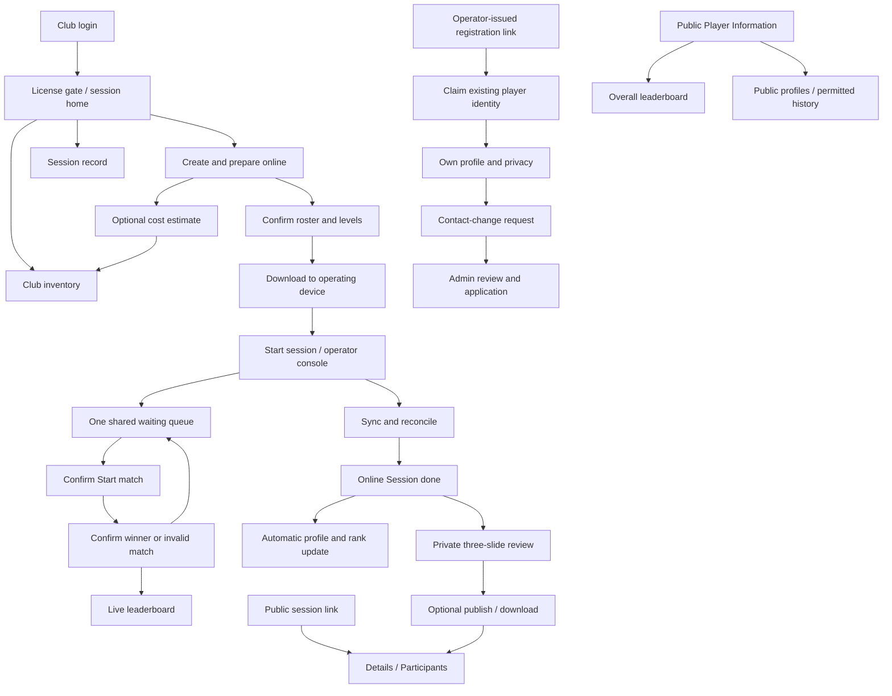

# Navigation and surface inventory

**Status:** Proposed information architecture. IDs below name documentation surfaces, not routes. A surface can be a page, panel, sheet, or dialog.

## Journey map

## Product navigation

- **Queue:** top bar with sync status and a light/dark mode switch on every operator screen. A collapsible left nav on every operator screen (burger in the top bar on wide screens, icon rail when collapsed; on phones a bottom dock with Menu, a highlighted Create/Continue session, and Settings): Live session (while live), Dashboard, Saved players, Venues, Inventory, Club settings, License, This device. Sign out is in Club settings. Home dashboard: club header with Create session, now card, calendar. Club settings has its own left-hand menu (on phones a button that opens it as a left drawer, closing the main menu first) and is unavailable offline. Each session's public page is also its session link; guests reach it from wherever the club shares it, never from the operator app's navigation. The live console has Session / Queue / Players / Leaderboard views and a footer with Session done. License gates remain global. Public session pages are a separate audience.
- **Player Information:** overall leaderboard and public profile reading; sign-in adds own profile, ID/QR, privacy, and contact requests. No World discovery entry.
- **Admin:** clubs/licenses, players/contact requests, ranking configuration, feature flags. No speculative analytics dashboard is required.

## Surface inventory

### Queue

| Module | Defined surfaces |
|---|---|
| [Queue access and session home](modules/queue/access-home.md) | `Q-LOGIN`, `Q-ACCESS`, `Q-HOME`, `Q-VENUES`, `Q-CLUB` |
| [Session financials and club inventory](modules/queue/financials-inventory.md) | `Q-FINANCIALS`, `Q-PAYMENTS`, `Q-INVENTORY`, `Q-INVENTORY-ITEM` |
| [Match start, substitutions, and permanent outcomes](modules/queue/match-control.md) | `Q-DISPATCH`, `Q-CHOOSE-MATCH`, `Q-ACTIVE-MATCH`, `Q-SUBSTITUTE`, `Q-MATCH-DONE`, `Q-INVALID-MATCH`, `Q-MATCH-RECORD` |
| [Shared match queue and generation](modules/queue/match-queue.md) | `Q-QUEUE`, `Q-MANUAL`, `Q-PICK-PLAYER`, `Q-SUGGEST`, `Q-AUTO`, `Q-REGENERATE` |
| [Offline readiness, sync, and interrupted-device recovery](modules/queue/offline-recovery.md) | `Q-SYNC`, `Q-DEVICE-CONTINUE`, `Q-INTERRUPTION`, `Q-CONFLICT`, `Q-UNRECOVERABLE` |
| [Saved players, identity entry, roster, and presence](modules/queue/players-roster.md) | `Q-SAVED-PLAYERS`, `Q-ADD-PLAYER`, `Q-IDENTIFY`, `Q-ASSESS`, `Q-ROSTER` |
| [Public session page](modules/queue/public-session.md) | `Q-PUBLIC-DETAILS`, `Q-PUBLIC-PARTICIPANTS`, `Q-PUBLIC-RESULTS`, `Q-PUBLIC-STALE` |
| [Private session results, publishing, exports, and history](modules/queue/results-sharing.md) | `Q-RESULTS`, `Q-STANDINGS-SLIDE`, `Q-AWARDS-SLIDE`, `Q-OFF-DAY-SLIDE`, `Q-PUBLISH`, `Q-EXPORT`, `Q-HISTORY` |
| [Active session console](modules/queue/session-console.md) | `Q-CONSOLE`, `Q-COURTS`, `Q-POOL`, `Q-LEADERBOARD`, `Q-SESSION-ADJUST`, `Q-ADD-COURT` |
| [Whole-session finalization](modules/queue/session-finalization.md) | `Q-SESSION-DONE`, `Q-FINALIZE-PROGRESS`, `Q-INVALID-SESSION` |
| [Session setup, preparation, download, and start](modules/queue/session-setup.md) | `Q-SETUP`, `Q-PREPARE`, `Q-DOWNLOAD`, `Q-START` |

### Player Information

| Module | Defined surfaces |
|---|---|
| [Player sign-in, registration claim, and password recovery](modules/player-information/access-registration.md) | `P-LOGIN`, `P-CLAIM`, `P-CLAIM-STATUS`, `P-FORGOT`, `P-RESET` |
| [Player ID, phone privacy, and contact-change request](modules/player-information/identity-privacy.md) | `P-ID-QR`, `P-PHONE-PRIVACY`, `P-CONTACT-REQUEST` |
| [Public and own player profile](modules/player-information/profile.md) | `P-PUBLIC-PROFILE`, `P-OWN-PROFILE`, `P-EDIT-PROFILE` |
| [Global leaderboard, rank explanation, and game history](modules/player-information/ranking-history.md) | `P-LEADERBOARD`, `P-RANK-DETAIL`, `P-ELIGIBILITY`, `P-MATCH-HISTORY` |

### Admin

| Module | Defined surfaces |
|---|---|
| [Admin access and workspace](modules/admin/access-navigation.md) | `A-LOGIN`, `A-WORKSPACE` |
| [Club directory, account detail, and manual licensing](modules/admin/clubs-licenses.md) | `A-CLUBS`, `A-ADD-CLUB`, `A-CLUB-DETAIL`, `A-CLUB-PRICE`, `A-LICENSE`, `A-RETENTION` |
| [Ranking settings and feature flags](modules/admin/configuration.md) | `A-RANK-CONFIG`, `A-FEATURE-FLAGS`, `A-ADD-FLAG` |
| [Player oversight and contact-change requests](modules/admin/players-requests.md) | `A-PLAYERS`, `A-PLAYER-DETAIL`, `A-CONTACT-REQUESTS`, `A-CONTACT-REVIEW` |

## Navigation and cancellation rules

- Returning from an editor preserves list/filter context; cancelling affects only unsaved draft changes.
- Match-result and invalid-match confirmation cannot be undone by browser Back.
- Session done failure returns to a meaningful processing/recovery state; do not reopen a finalized session because of a lost response.
- Reauthentication/licensing transitions preserve unsynced evidence but do not reveal blocked club reports.
- Public profile/session links do not become permission to edit the corresponding records.
- Do not add route paths to this document until route architecture is chosen; old routes are not assumed to match the reset.

Inventory total: **86 surfaces across 19 module specifications**, plus the shared confirmation-dialog contract. (Updated October 26, 2026: +8 Queue surfaces from the [ROTRA Queue prototype](../../frames/queue-app/rotra-queue.html). Updated October 27, 2026: +3 Admin surfaces from the [ROTRA Admin prototype](../../frames/admin-app/rotra-admin.html).)
