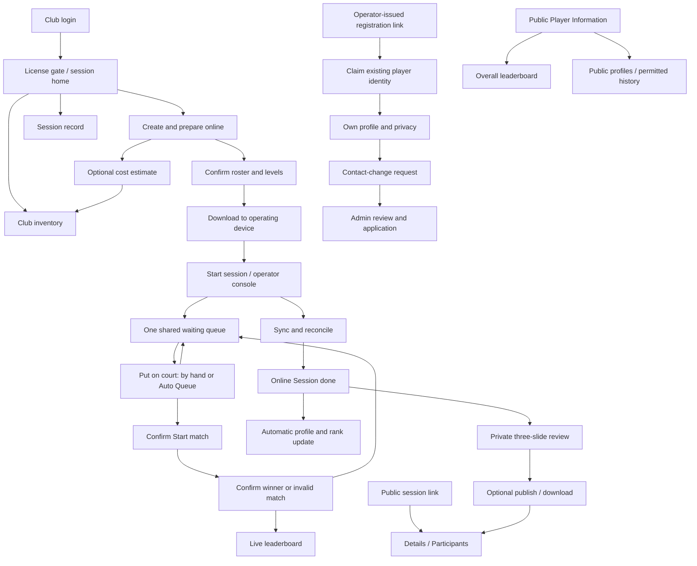

# Navigation and surface inventory

**Status:** Proposed information architecture. IDs below name documentation surfaces, not routes. A surface can be a page, panel, sheet, or dialog.

## Journey map

## Product navigation

- **Queue:** top bar with sync status and a light/dark mode switch on every operator screen. A collapsible left nav on every operator screen (burger in the top bar on wide screens, icon rail when collapsed; on phones a bottom dock with Menu, a highlighted Create/Continue session, and Settings): Live session (while live), Dashboard, Saved players, Leaderboards (`/leaderboards`, `?tab=rotra` for the ROTRA board; [D-2026-11-25-04](../../mvp/decisions/2026-11-25.md#d-2026-11-25-04)), Venues, Inventory, Club settings, License, This device. Sign out is in Club settings. Home dashboard: club header with Create session, now card, calendar. Club settings has its own left-hand menu (on phones a button that opens it as a left drawer, closing the main menu first) and is unavailable offline. Each session's public page is also its session link; guests reach it from wherever the club shares it, never from the operator app's navigation. The live console has Session / Queue / Players / Leaderboard views and a footer with Session done. License gates remain global. Public session pages are a separate audience.
- **Player Information:** overall leaderboard and public profile reading; sign-in adds Home (`/home`: current session, upcoming sessions, clubs and stats), own profile, ID/QR, privacy, and contact requests. No World discovery entry.
- **Admin:** clubs/licenses, players/contact requests, ranking configuration, feature flags. No speculative analytics dashboard is required.

## Surface inventory

### Queue

| Module | Defined surfaces |
|---|---|
| [Queue access and session home](modules/queue/access-home.md) | `Q-LOGIN`, `Q-ACCESS`, `Q-HOME`, `Q-VENUES`, `Q-CLUB` |
| [Session financials and club inventory](modules/queue/financials-inventory.md) | `Q-FINANCIALS`, `Q-PAYMENTS`, `Q-INVENTORY`, `Q-INVENTORY-ITEM` |
| [Match start, substitutions, and permanent outcomes](modules/queue/match-control.md) | `Q-DISPATCH`, `Q-CHOOSE-MATCH`, `Q-ON-COURT`, `Q-ACTIVE-MATCH`, `Q-SUBSTITUTE`, `Q-MATCH-DONE`, `Q-NEXT-MATCH`, `Q-INVALID-MATCH`, `Q-MATCH-RECORD` |
| [Shared match queue and generation](modules/queue/match-queue.md) | `Q-QUEUE`, `Q-MANUAL`, `Q-PICK-PLAYER`, `Q-SUGGEST`, `Q-AUTO`, `Q-REGENERATE` |
| [Offline readiness, sync, and interrupted-device recovery](modules/queue/offline-recovery.md) | `Q-SYNC`, `Q-DEVICE-CONTINUE`, `Q-INTERRUPTION`, `Q-CONFLICT`, `Q-UNRECOVERABLE` |
| [Saved players, identity entry, roster, and presence](modules/queue/players-roster.md) | `Q-SAVED-PLAYERS`, `Q-ADD-PLAYER`, `Q-IDENTIFY`, `Q-ASSESS`, `Q-ROSTER` |
| [Public session page](modules/queue/public-session.md) | `Q-PUBLIC-DETAILS`, `Q-PUBLIC-PARTICIPANTS`, `Q-PUBLIC-RESULTS`, `Q-PUBLIC-STALE` |
| [Private session results, publishing, exports, and history](modules/queue/results-sharing.md) | `Q-RESULTS`, `Q-STANDINGS-SLIDE`, `Q-AWARDS-SLIDE`, `Q-OFF-DAY-SLIDE`, `Q-PUBLISH`, `Q-EXPORT`, `Q-HISTORY` |
| [Active session console](modules/queue/session-console.md) | `Q-CONSOLE`, `Q-COURTS`, `Q-POOL`, `Q-LEADERBOARD`, `Q-SESSION-ADJUST`, `Q-ADD-COURT` |
| [Leaderboards](modules/queue/leaderboards.md) | `Q-LEADERBOARDS`, `Q-PODIUM-PLACE` |
| [Whole-session finalization](modules/queue/session-finalization.md) | `Q-SESSION-DONE`, `Q-FINALIZE-PROGRESS`, `Q-INVALID-SESSION` |
| [Session setup, preparation, download, and start](modules/queue/session-setup.md) | `Q-SETUP`, `Q-PREPARE`, `Q-DOWNLOAD`, `Q-START` |

### Player Information

| Module | Defined surfaces |
|---|---|
| [Player sign-in, registration claim, and password recovery](modules/player-information/access-registration.md) | `P-LOGIN`, `P-CLAIM`, `P-CLAIM-STATUS`, `P-FORGOT`, `P-RESET` |
| [Player ID, profile visibility, phone privacy, and contact-change request](modules/player-information/identity-privacy.md) | `P-ID-QR`, `P-PROFILE-PRIVACY`, `P-PHONE-PRIVACY`, `P-CONTACT-REQUEST` |
| [Public and own player profile](modules/player-information/profile.md) | `P-PUBLIC-PROFILE`, `P-OWN-PROFILE`, `P-EDIT-PROFILE` |
| [Public club page and club members](modules/player-information/club-page.md) | `P-CLUB-PAGE`, `P-CLUB-MEMBERS` |
| [Global leaderboard, rank explanation, and game history](modules/player-information/ranking-history.md) | `P-LEADERBOARD`, `P-RANK-DETAIL`, `P-ELIGIBILITY`, `P-MATCH-HISTORY` |
| [Public match page](modules/player-information/match-page.md) | `P-MATCH-PAGE` |
| [Legal pages](modules/player-information/legal.md) | `P-PRIVACY`, `P-TERMS` |

### Admin

| Module | Defined surfaces |
|---|---|
| [Admin access and workspace](modules/admin/access-navigation.md) | `A-LOGIN`, `A-WORKSPACE` |
| [Club directory, account detail, and manual licensing](modules/admin/clubs-licenses.md) | `A-CLUBS`, `A-ADD-CLUB`, `A-CLUB-DETAIL`, `A-CLUB-PRICE`, `A-LICENSE`, `A-RETENTION` |
| [Ranking settings and feature flags](modules/admin/configuration.md) | `A-RANK-CONFIG`, `A-FEATURE-FLAGS`, `A-ADD-FLAG` |
| [Player oversight and contact-change requests](modules/admin/players-requests.md) | `A-PLAYERS`, `A-PLAYER-DETAIL`, `A-CONTACT-REQUESTS`, `A-CONTACT-REVIEW` |

## Navigation and cancellation rules

- Returning from an editor preserves list/filter context; cancelling affects only unsaved draft changes.
- Match-result and invalid-match confirmation cannot be undone by browser Back.
- Session done failure returns to a meaningful processing/recovery state; do not reopen a finalized session because of a lost response.
- Reauthentication/licensing transitions preserve unsynced evidence but do not reveal blocked club reports.
- Public profile/session links do not become permission to edit the corresponding records.
- A cancelled session (owner decision, November 6, 2026) opens only as its read-only session record (`Q-HISTORY`, cancelled form). Opening its preparation (or its edit) leads to that record; its public link stays and says Cancelled.
- Do not add route paths to this document until route architecture is chosen; old routes are not assumed to match the reset.

Inventory total: **86 surfaces across 19 module specifications**, plus the shared confirmation-dialog contract. (Updated October 26, 2026: +8 Queue surfaces from the [ROTRA Queue prototype](../../../apps/mockup/queue-app/rotra-queue.html). Updated October 27, 2026: +3 Admin surfaces from the [ROTRA Admin prototype](../../../apps/mockup/admin-app/rotra-admin.html).)

## Foundation route boundary (approved October 27, 2026)

All apps use `/login`. Queue public session links use `/s/[slug]`; the rest of Queue is protected. The operator preview `/sessions/[sessionId]/public-page` is the one exception to the sign-in redirect: anyone but the owning club is sent to that session's `/s/[slug]` instead of `/login`.
Admin routes except `/login` are protected. Player `/` (leaderboard) and `/players/[playerId]` are
public; `/home` (P-HOME, November 19, 2026), `/me` and their children are protected. The Foundation proxy wires these boundaries only;
sign-in forms and the remaining screens arrive in their product tickets.

P-COMPARE is `/players/[playerId]/compare` ([D-2026-11-08-02](../../mvp/decisions/2026-11-08.md#d-2026-11-08-02)): it
needs a signed-in player, so signed out it goes to `/login` and returns there.

P-VERIFICATION is `/profile/verification` and requires a signed-in player. Signed-out players go to `/login` and return to Verification after signing in.

Guest registration invitations (#490) open `/register/[clubId]` in Player Information, with no
sign-in required. The club is RTR allocation context only; existing profiles still use `/claim/[token]`.

While the `player_google_sign_in` flag is on (#919), the same routes show the invite landing: `/register/[clubId]`, `/register/[clubId]?session=<slug>&invite=<code>` and `/register` start with the invite card (P-INVITE) and **Continue with Google**; a signed-in player gets P-JOIN-CLUB or P-JOIN-SESSION instead. The invite page links to `/login?returnTo=<this route>` (the Admin link to plain `/login`), and an existing player who picks Google goes through `/connect-google` and back to this route. A signed-in player on `/register` goes to their profile. With the flag off the email + password registration is unchanged.

### Player club routes (epic P07)

Proposed November 11, 2026 ([D-2026-11-11-11](../../mvp/decisions/2026-11-11.md#d-2026-11-11-11)): `/clubs/[clubId]` (`P-CLUB-PAGE`) and `/clubs/[clubId]/members` (`P-CLUB-MEMBERS`) in Player Information. Both are public (no sign-in), served per request, never indexed and never static; signed-out visitors see masked member names. Linked from the clubs card on every readable profile ([D-2026-11-12-04](../../mvp/decisions/2026-11-12.md#d-2026-11-12-04)). The Members page's back link returns to the club page. Member taps open the profile dialog and don't navigate. Unknown club ids are not found. The prototype serves them under `/player/clubs/c1`. Proposed November 25, 2026 ([D-2026-11-25-04](../../mvp/decisions/2026-11-25.md#d-2026-11-25-04)): `/clubs/[clubId]/leaderboard` (`P-CLUB-LEADERBOARD`), opened from **See all** on the club page's Leaderboard card; public, with a back link to the club page.

### Player match route

Owner decision, November 25, 2026 ([log](../../mockup-changes/2026-11-25-player-match-page.md)): `/matches/[matchId]` (`P-MATCH-PAGE`) in Player Information, one public page per match, the same for every player in it. Public (no sign-in); names follow the profile privacy rules. Opened by tapping any game court and from the **Link** field of **Share game**. Its back link returns to the page the court was tapped on, else the leaderboard. Unknown match ids show the page's not-found state. The prototype serves it under `/player/matches/m1-2`.

### Player legal routes

Decided November 17, 2026 ([D-2026-11-17-01](../../mvp/decisions/2026-11-17.md#d-2026-11-17-01)): `/privacy` (`P-PRIVACY`) and `/terms` (`P-TERMS`) in Player Information. Both are public (no sign-in) in mock and real mode, and static. The Google sign-in consent screen and P-LOGIN link to them. The prototype serves them under `/player/privacy` and `/player/terms`.
